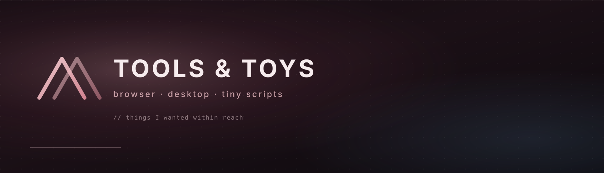

  

 

  <em>пишу то, что самому нужно вечером — расширения, мелкие приложения, визуальные игрушки.</em>

 

  
  
  
  
  

---

### на полке

| | |
| :--- | :--- |
| **[proBaws.js](https://github.com/ivannikovaleksej10/proBaws.js)** · js plugin | прогресс-бар, который едет вместе со скроллом. [демо](https://ivannikovaleksej10.github.io/proBaws.js/) |
| **[No Shorts for YouTube](https://github.com/ivannikovaleksej10/No-Shorts-for-YouTube)** · firefox / chrome | вычищает Shorts из меню, рекомендаций и отдельных блоков |
| **[stream-notifier](https://github.com/ivannikovaleksej10/stream-notifier)** · node | когда стрим стартанул — пинг в telegram и discord |
| **[snowfall-js](https://github.com/ivannikovaleksej10/snowfall-js)** · jquery | снег падает по странице. [демо](https://ivannikovaleksej10.github.io/snowfall-js/) |
| **[Password Generator](https://github.com/ivannikovaleksej10/Password-Generator)** · winforms | длина, алфавит, готовый пароль. [страница](https://ivannikovaleksej10.github.io/Password-Generator/) |
| **[ColorPickerApp2](https://github.com/ivannikovaleksej10/ColorPickerApp2)** · csharp | цвет выделения на рабочем столе windows, без лишних окон |

ещё из того, что не стыдно открыть

 

- **[server-stats](https://github.com/ivannikovaleksej10/server-stats)** — нагрузка удалённой машины
- **[godot-crt-shader](https://github.com/ivannikovaleksej10/godot-crt-shader)** — эмуляция электронно-лучевой трубки
- **[gulp-template](https://github.com/ivannikovaleksej10/gulp-template)** — gulp + webpack, чтобы не собирать с нуля
- **[matrix-bg-js](https://github.com/ivannikovaleksej10/matrix-bg-js)** — зелёный дождь с canvas. [демо](https://ivannikovaleksej10.github.io/matrix-bg-js/)
- **[snake-game-js](https://github.com/ivannikovaleksej10/snake-game-js)** — змейка в браузере. [демо](https://ivannikovaleksej10.github.io/snake-game-js/)
- **[3d-hover-card-effect](https://github.com/ivannikovaleksej10/3d-hover-card-effect)** — карточка с перспективой. [демо](https://ivannikovaleksej10.github.io/3d-hover-card-effect/)
- **[Hover-effect-following-the-cursor](https://github.com/ivannikovaleksej10/Hover-effect-following-the-cursor)** — подчёркивание, которое догоняет курсор. [демо](https://ivannikovaleksej10.github.io/Hover-effect-following-the-cursor/)
- **[Windows-Forms-FormBorderStyle-None](https://github.com/ivannikovaleksej10/Windows-Forms-FormBorderStyle-None)** — кастомное окно без рамки winforms

---

  
  

  

